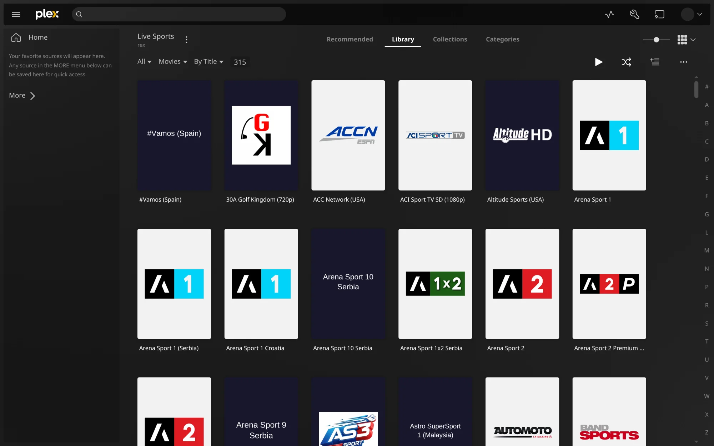
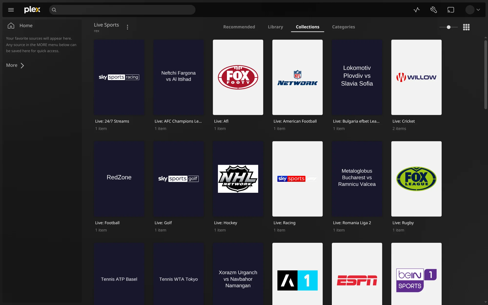
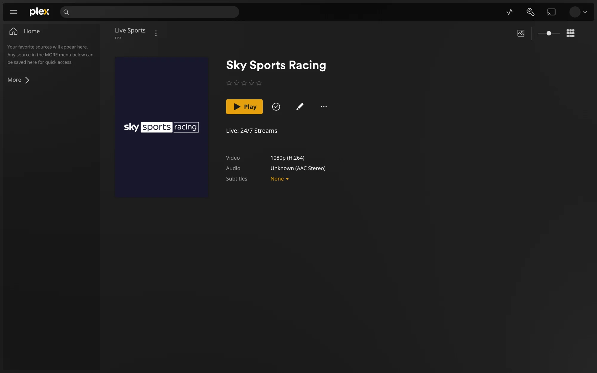
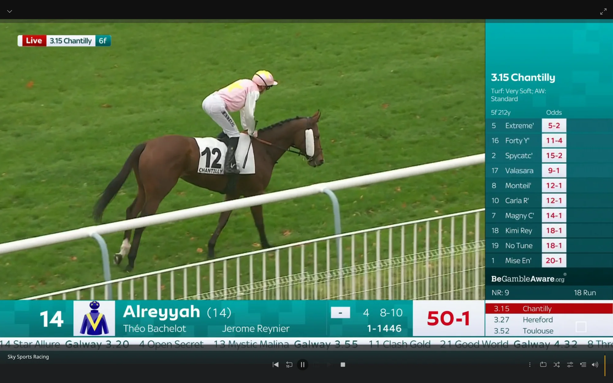

# rex-live-sports

The sports channels of your [live-sports](https://github.com/yowmamasita/live-sports-public) server
as a library in [rex](https://rex.debridmediamanager.com), so they play in every Plex app. Nothing
is recorded: when someone presses play, rex reads the channel from live-sports as it airs.

- **Only channels that play.** live-sports checks every channel every few minutes. Whatever
  passes shows up in the **Live Sports** library within five minutes, and what stops playing
  leaves it.
- **Sorted the way live-sports sorts them.** Each group is a collection in the library:
  `Live: Football`, `Live: Tennis ATP`, `Sports: UK` and so on.
- **Channel logos.** Each channel gets a poster and a background with its logo, from
  [iptv-org](https://github.com/iptv-org/database)'s channel list (about three in four sports
  channels have one), or with its name where there is no logo, such as a single match.
- **Live, not a recording.** rex plays each channel as a live broadcast, with no end and no
  resume point, and never marks it watched.



| Each group is a collection | A channel | Playing live |
|---|---|---|
|  |  |  |

It is one Python file (standard library only) that runs beside rex and talks to it through rex's
feed API, as every rex source does.

## What you need

| You need | Why |
|---|---|
| rex, nightly 2026.10.26 or newer | Older builds do not take collections, and before 2026.10.25 stop a live channel after a few seconds. Setup: [rex](https://notes.debridmediamanager.com/guides/rex/) |
| A live-sports server, on this machine or your home network | It finds the channels and serves them. See its README; Docker: `docker run -d -p 8765:8765 ghcr.io/yowmamasita/live-sports:latest` |
| Python 3.9 or newer, and FFmpeg (`ffmpeg` and `ffprobe`) | rex-live-sports checks each channel's stream once a day with ffprobe, because rex needs to know what is in it before it can play, and draws the posters with ffmpeg |
| FFmpeg where rex runs | rex plays HLS channels by converting them (a copy, cheap) |
| rex-live-sports on the same machine as rex, or on your home network | rex's feed answers only private networks |

## Set up

```bash
git clone https://github.com/debridmediamanager/rex-live-sports
cd rex-live-sports
cp config.example.json config.json
```

In `config.json`, set `live_sports_url` to your live-sports server and `rex_url` to rex's
address, then start it. Use addresses rex can reach too: rex plays each channel from
`live_sports_url`.

```bash
python3 rex_live_sports.py
```

The first sync checks every channel, several minutes for several hundred. After that it syncs
every five minutes and checks only the channels it has not seen today.

To run it as a service, copy `rex-live-sports.service` to `~/.config/systemd/user/` and run
`systemctl --user daemon-reload && systemctl --user enable --now rex-live-sports`. With Docker:

```bash
docker build -t rex-live-sports .
docker run -d --name rex-live-sports -p 9983:9983 -v "$PWD/data:/data" rex-live-sports
```

In Docker, put your `config.json` in `data/` with `listen` set to `0.0.0.0:9983`, `relay_url`
set to an address rex can reach the container at, and `live_sports_url` and `rex_url` set to
your machine's address, not `127.0.0.1` or a container's name:

```json
{
  "live_sports_url": "http://192.168.1.20:8765",
  "rex_url": "http://192.168.1.20:32400",
  "listen": "0.0.0.0:9983",
  "relay_url": "http://192.168.1.20:9983"
}
```

## Settings

Edit `config.json` and restart:

| Key | Default | What it is |
|---|---|---|
| `live_sports_url` | `http://127.0.0.1:8765` | Your live-sports server, at an address rex reaches too |
| `rex_url` | `http://127.0.0.1:32400` | rex's address |
| `listen` | `127.0.0.1:9983` | Where the relay answers. rex reads each channel and its pictures through it |
| `relay_url` | `http://<listen>` | The address rex reads the relay at, when rex runs on another machine or in Docker |
| `groups` | `["Live:", "Sports"]` | Which of live-sports' groups to take, by how their names start. `["Live:"]` takes only events and 24/7 event channels; add `"TV:"` for its general TV |
| `library` | `Live Sports` | The library's name in rex |
| `directory` | `live-sports` | The folder the channels are under. A change makes them new items in rex |
| `mount` | `/mnt/rex-live-sports` | The folder name rex shows for these files. Nothing is mounted |
| `source` | `live-sports` | The name rex knows this source by |
| `cache` | `cache` | Where each channel's stream check is kept |
| `ffprobe`, `ffmpeg` | `ffprobe`, `ffmpeg` | The ffprobe and ffmpeg to use |
| `interval_minutes` | `5` | How often to sync |
| `probe_hours` | `24` | How long a channel's stream check is kept |

## Limits

- rex knows each channel by its name. When live-sports lists another copy of it, that copy is
  checked and the channel plays from it. A copy whose stream changes within the day it is kept
  (another codec) can fail to play until it is checked again; delete its file in `cache/` to
  check it on the next sync.
- Logos are matched by the channel's name, with its country when live-sports names one. A
  channel whose name iptv-org gives to another country's channel of the same brand gets that
  logo (Fox Sports 2 Argentina gets Fox Sports 2's).
- A few logos are SVG files. An ffmpeg built without SVG support (gyan.dev's Windows builds)
  cannot draw them, and those channels get their name instead.
- Channels with several qualities play the one FFmpeg picks first, which can be the lowest.
- When live-sports lists fewer than half the channels rex holds (it does for a few minutes after
  it starts), rex keeps them all for up to half an hour, while live-sports checks them again.
- Anyone who can reach `listen` can use the relay to reach your live-sports server. Keep it on
  `127.0.0.1` unless rex runs elsewhere.

## Tests

```bash
python3 -m unittest discover -s tests
REX_BIN=/path/to/rex python3 -m unittest discover -s tests   # also syncs into a real rex
```

The fixtures are a real live-sports catalog (1,117 channels, 624 of them sports), a real
channel's probe and iptv-org's channel and logo lists for those names.

## License

MIT
