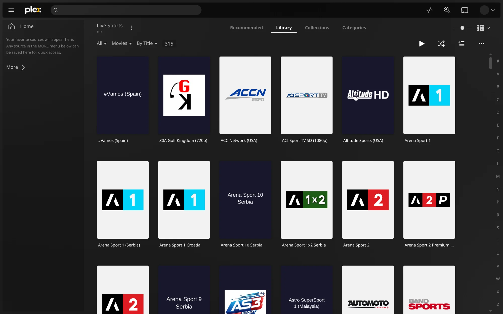
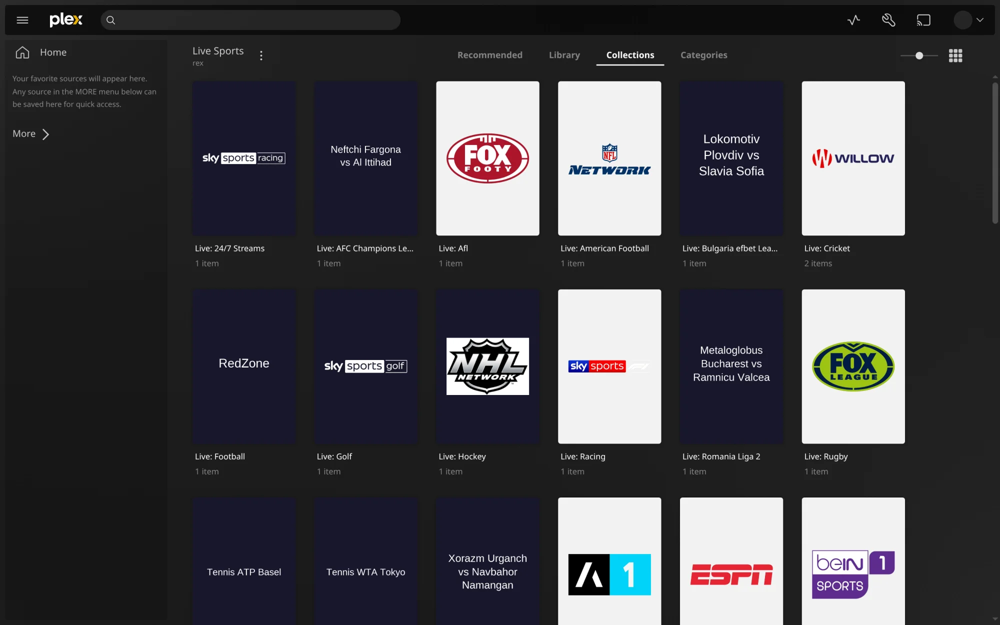
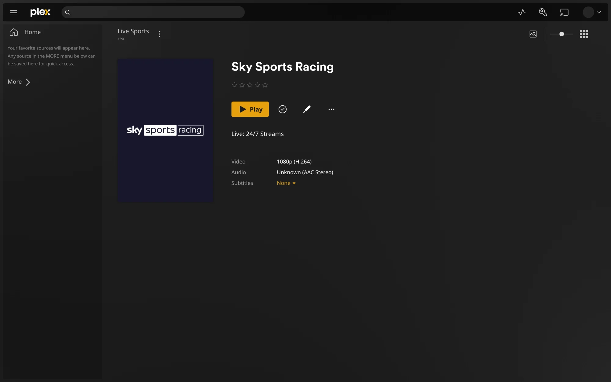
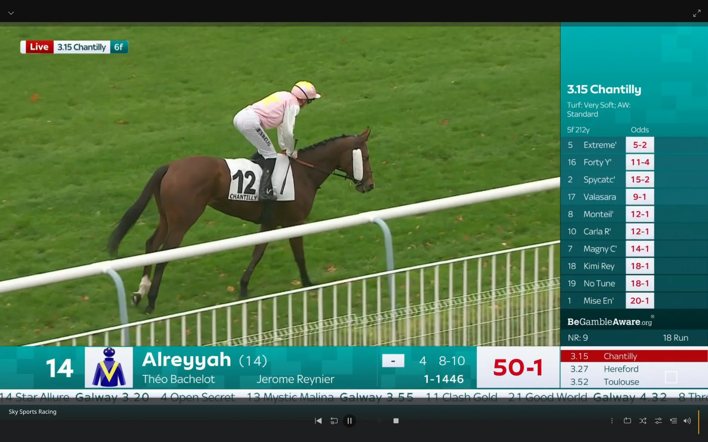
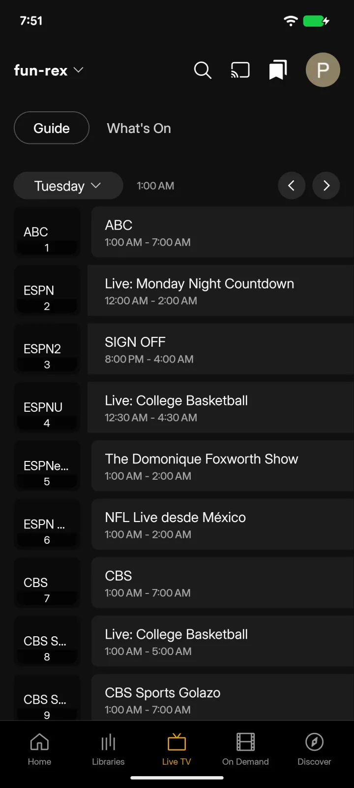
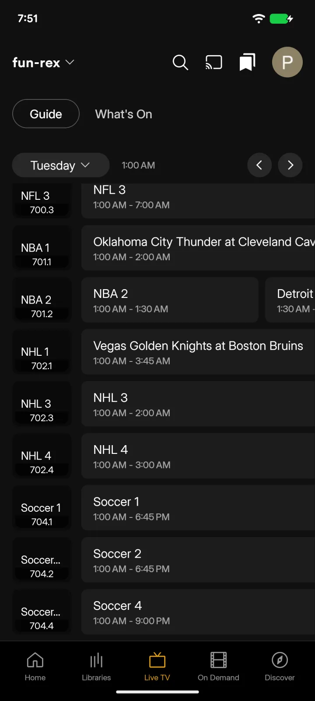

# rex-live-sports

The sports channels of your [live-sports](https://github.com/yowmamasita/live-sports-public) server
as a library in [rex](https://rex.debridmediamanager.com), so they play in every Plex app. Nothing
is recorded: when someone presses play, rex reads the channel from live-sports as it airs.

- **Only channels that play.** live-sports checks every channel every few minutes. Whatever
  passes shows up in the **Live Sports** library within five minutes, and what stops playing
  leaves it.
- **Sorted the way live-sports sorts them.** Each group is a collection in the library:
  `Live: Football`, `Live: Tennis ATP`, `Sports: UK` and so on.
- **Channel logos.** Each channel gets a poster and a background with its logo, from
  [iptv-org](https://github.com/iptv-org/database)'s channel list (about three in four sports
  channels have one), or with its name where there is no logo, such as a single match.
- **Live, not a recording.** rex plays each channel as a live broadcast, with no end and no
  resume point, and never marks it watched.
- **A TV guide.** Each channel is also a channel of rex's **Live TV**, with its own number and
  what is on it: Plex Web and Plex for Android show the guide and What's On, and play a channel from there.
  See [Live TV](#live-tv).
- **A lineup, like a TV provider's.** With the US, UK or German lineup, Live TV is about 30
  sports networks at numbers that never change (ESPN is 2), with ESPN's schedule of the games on
  them, and slot channels that list the day's games before they start and play each one live.
  See [Lineups](#lineups).



| Each group is a collection | A channel | Playing live |
|---|---|---|
|  |  |  |

| The US lineup in Plex for Android's guide | The slots: the night's NBA and NHL games |
|---|---|
|  |  |

It is one Python file (standard library only) that runs beside rex and talks to it through rex's
feed API, as every rex source does.

## What you need

| You need | Why |
|---|---|
| rex, nightly 2026.10.26 or newer | Older builds do not take collections, and before 2026.10.25 stop a live channel after a few seconds. Setup: [rex with your own app](https://notes.debridmediamanager.com/rex/any-source/) |
| A live-sports server, on this machine or your home network | It finds the channels and serves them. See its README; Docker: `docker run -d -p 8765:8765 ghcr.io/yowmamasita/live-sports:latest` |
| Python 3.9 or newer, and FFmpeg (`ffmpeg` and `ffprobe`) | rex-live-sports checks each channel's stream once a day with ffprobe, because rex needs to know what is in it before it can play, and draws the posters with ffmpeg |
| FFmpeg where rex runs | rex plays HLS channels by converting them (a copy, cheap) |
| rex-live-sports on the same machine as rex, or on your home network | rex's feed answers only private networks |

## Set up

```bash
git clone https://github.com/debridmediamanager/rex-live-sports
cd rex-live-sports
cp config.example.json config.json
```

In `config.json`, set `live_sports_url` to your live-sports server and `rex_url` to rex's
address, then start it. Use addresses rex can reach too: rex plays each channel from
`live_sports_url`. The example uses the US lineup (`lineups/us.json`): put `lineups/uk.json` or
`lineups/de.json` there instead, or take the line out to have every channel live-sports has.

```bash
python3 rex_live_sports.py
```

The first sync checks every channel, several minutes for several hundred. After that it syncs
every five minutes and checks only the channels it has not seen today.

To run it as a service, copy `rex-live-sports.service` to `~/.config/systemd/user/` and run
`systemctl --user daemon-reload && systemctl --user enable --now rex-live-sports`. With Docker:

```bash
docker build -t rex-live-sports .
docker run -d --name rex-live-sports -p 9983:9983 -v "$PWD/data:/data" rex-live-sports
```

In Docker, put your `config.json` in `data/` with `listen` set to `0.0.0.0:9983`, `relay_url`
set to an address rex can reach the container at, and `live_sports_url` and `rex_url` set to
your machine's address, not `127.0.0.1` or a container's name. The lineups are in the image,
in `/app/lineups`:

```json
{
  "live_sports_url": "http://192.168.1.20:8765",
  "rex_url": "http://192.168.1.20:32400",
  "listen": "0.0.0.0:9983",
  "relay_url": "http://192.168.1.20:9983",
  "lineup": "/app/lineups/us.json"
}
```

## Settings

Edit `config.json` and restart:

| Key | Default | What it is |
|---|---|---|
| `live_sports_url` | `http://127.0.0.1:8765` | Your live-sports server, at an address rex reaches too |
| `rex_url` | `http://127.0.0.1:32400` | rex's address |
| `listen` | `127.0.0.1:9983` | Where the relay answers. rex reads each channel and its pictures through it |
| `relay_url` | `http://<listen>` | The address rex reads the relay at, when rex runs on another machine or in Docker |
| `groups` | `["Live:", "Sports"]` | Which of live-sports' groups to take, by how their names start. `["Live:"]` takes only events and 24/7 event channels; add `"TV:"` for its general TV and `"Pluto:"` for Pluto TV's channels |
| `library` | `Live Sports` | The library's name in rex |
| `directory` | `live-sports` | The folder the channels are under. A change makes them new items in rex |
| `mount` | `/mnt/rex-live-sports` | The folder name rex shows for these files. Nothing is mounted |
| `source` | `live-sports` | The name rex knows this source by |
| `cache` | `cache` | Where stream checks, channel numbers and guides are kept |
| `ffprobe`, `ffmpeg` | `ffprobe`, `ffmpeg` | The ffprobe and ffmpeg to use |
| `interval_minutes` | `5` | How often to sync |
| `probe_hours` | `24` | How long a channel's stream check is kept |
| `live_tv` | `true` | Each channel is also a channel of rex's Live TV. `false` takes them out of it; they stay in the library |
| `lineup` | `lineup.json` | The [lineup](#lineups), beside `config.json` unless its path says where: `lineups/us.json`, `lineups/uk.json`, `lineups/de.json` or your own. With no such file, every channel is in Live TV, numbered by group |
| `lineup_only` | `true` | With a lineup, only its channels and the slots. `false` keeps the rest of live-sports' channels too, numbered from 100 as without one |
| `slots` | `{"NFL": 10, "NBA": 6, "NHL": 6, "MLB": 4, "Soccer": 8, "F1": 1}` | With a lineup, how many slots each sport has. A sport left out has none; `"College Football": 4` adds college football's |

## Live TV

rex shows the channels in **Live TV** in Plex Web and Plex for Android as well, as a tuner with a guide would. [Live TV with rex](https://notes.debridmediamanager.com/rex/live-tv/) walks
through the setup.
The library stays as it is. It needs a rex nightly dated 2026.11.02 or newer; an older rex ignores it.

- **Numbers.** A channel's number is its group's and its own: `100.1`, `100.2`, then `101.1` for
  the next group, clear of the low numbers a tuner or another source uses (rex has one guide for
  all of them). Groups are numbered in the order of their names (`Live: ...` first, then
  `Sports`, `Sports: Argentina` and so on), and the channels of a group in the order of theirs.
  A channel keeps its number while live-sports lists it at least once a week, wherever its group
  goes; after that the number is free for a new channel. New channels and groups take the lowest
  number free. The numbers are kept in `cache/channels.json`.
- **Guides.** A Pluto TV channel (the `Pluto:` groups) gets Pluto TV's own schedule. Any other
  channel gets [epgshare01](https://epgshare01.online/)'s guide of the channel of its name in its
  country: the one its name or group names (`ESPN (Argentina)`, `Sky Sports F1 UK`,
  `Sports: Spain`), else the one iptv-org gives a channel of that name. Both are free and need no
  key. Guides are fetched every 12 hours, from three hours back to two days ahead.
- **Every other channel**, and every single match (`Real Madrid vs Barcelona`), shows its own
  name in the guide, in blocks of six hours, under its group's sport (`Live: Football` is
  Sports and Football).

Measured on 2026-11-01 on a live-sports server's channels: Pluto TV had the schedule of all 197
of its own, epgshare01 the guide of 202 of 689 sports channels and 133 of 348 general TV ones.
Many of the rest are named by an event, a server or a backup (`DAZN EVENT 5 HD .b`), which no
guide lists.

## Lineups

A lineup turns Live TV into what a TV provider shows: a short list of networks at numbers that
never change, the games on them in the guide, and the day's games before they start. It needs a
live-sports whose catalog gives each channel its `key`; with an older one, no channel of a
lineup is found.

- **Its channels, at its numbers.** `lineups/us.json` has 30 US networks (ABC 1, ESPN 2, CBS 7,
  FOX 10, FS1 11, NBC 14, NFL Network 15, NBA TV 17 and so on), `lineups/uk.json` 30 UK ones (Sky
  Sports, TNT Sports, Premier Sports, LaLiga TV), `lineups/de.json` 30 German ones (Sky Sport,
  DAZN, SPORT1, Eurosport, MagentaSport). Each is a channel live-sports had on 2026-11-01. A
  channel is there, under the lineup's name, while live-sports has a copy of it that plays,
  whichever copy that is. The rest of live-sports is left out, unless `lineup_only` is `false`.
- **ESPN's schedule.** A US network ESPN names as a game's broadcaster (ESPN, CBS, FOX, NBC, NFL
  Network and others) has that game in its guide, `Chicago Bears at Seattle Seahawks`, from
  kickoff for the sport's usual length (NFL 3¼ hours, NBA 2½, NHL 2¾, MLB 3, soccer and F1 2),
  with the home team's logo. The leagues: NFL, college football, NBA, NHL, MLB, Premier League,
  Bundesliga, LaLiga, Serie A, Ligue 1, Champions League, Europa League, MLS and F1. Around the
  games the guide is as before. ESPN names only US broadcasters, so the UK and German channels
  get no games from it.
- **Slots.** Each sport has slot channels: `NFL 1` to `NFL 10` (700.1 to 700.10), `NBA 1` to
  `NBA 6` (701.1 on), then NHL, MLB, Soccer and F1, each sport a collection. Each game goes to
  the first slot of its sport that is free at kickoff, the game before it over by the sport's
  usual length, so the guide shows what is coming in each. From 15 minutes before
  kickoff until the game is over, a slot plays the live-sports channel that has it, whatever
  its group: one whose name has both teams (`Kansas City Chiefs vs Denver Broncos`, `Denver
  Broncos vs Kansas City Chiefs (LOW SERVER)`), the sharpest picture first, then the shortest name.
  An F1 slot plays a channel with F1 in its name.
- **Between games** a slot does not play, and stays as it was at its last game; its guide shows
  its name there, as a channel with no guide does. A slot shows up the first time it plays a
  game.
- **Your own lineup** is a JSON list like the ones in `lineups/`: `{"number": "2", "name":
  "ESPN", "key": "espn/united states", "espn": ["ESPN"]}`. `key` is live-sports' key of the
  channel (in its catalog: the name in lower-case letters and digits, `/`, its country), or a
  list of them for a channel live-sports lists under several (`["bigten/united states",
  "btn/united states"]`): the first one it lists is taken.
  `espn` is optional: the names ESPN gives the network (`Fox`, `NFL Net`, `CBSSN`).

## Limits

- rex knows each channel by its name. When live-sports lists another copy of it, that copy is
  checked and the channel plays from it. A copy whose stream changes within the day it is kept
  (another codec) can fail to play until it is checked again; delete its file in `cache/` to
  check it on the next sync.
- Logos are matched by the channel's name, with its country when live-sports names one. A
  channel whose name iptv-org gives to another country's channel of the same brand gets that
  logo (Fox Sports 2 Argentina gets Fox Sports 2's).
- A few logos are SVG files. An ffmpeg built without SVG support (gyan.dev's Windows builds)
  cannot draw them, and those channels get their name instead.
- Channels with several qualities play the one FFmpeg picks first, which can be the lowest.
- When live-sports lists fewer than half the channels rex holds (it does for a few minutes after
  it starts), rex keeps them all for up to half an hour, while live-sports checks them again.
  With a lineup, that is fewer than half of its channels and slots, so the first sync with one
  replaces what rex held before it at once.
- Anyone who can reach `listen` can use the relay to reach your live-sports server. Keep it on
  `127.0.0.1` unless rex runs elsewhere.
- Guides are matched by name, like logos, so a channel can get the guide of another feed of the
  same brand (Sky Sports Cricket gets Ireland's, the same programmes).
- Plex files a guide programme with no episode number as a film, as it does with any XMLTV
  guide, so matches and the names of channels with no guide also show under What's On's films.
- epgshare01's guides for the countries of live-sports' sports channels are about 100 MB, kept
  in `cache/guides` and downloaded again only when epgshare01 has rebuilt them.
- A slot finds a game's channel by the teams in its name, so a stream named otherwise (`nfl
  ravens`) is not found, and a game no channel has is in the guide but does not play.
- When no slot of a sport is free at a game's kickoff, the game goes to the one whose game ends
  soonest. That slot plays its earlier game to the end, then the later one.
- Where ESPN names one network for several games at once (CBS's and FOX's regional NFL games),
  that channel's guide shows one of them.

## Tests

```bash
python3 -m unittest discover -s tests
REX_BIN=/path/to/rex python3 -m unittest discover -s tests   # also syncs into a real rex
```

The fixtures are a real live-sports catalog (1,117 channels, 624 of them sports), a real
channel's probe, iptv-org's channel and logo lists for those names, and real guides: Pluto TV's
schedule of three channels and epgshare01's UK guide of four. For lineups, a real catalog with
its keys (the lineups' channels and live-sports' `Live:` groups) and ESPN's scoreboards of an NFL
Sunday and Monday, with the NBA's, the Premier League's and an F1 weekend.

## License

MIT

---

**More from DMM:** [Debrid Media Manager](https://debridmediamanager.com/) · [zurg](https://zurg.debridmediamanager.com/) · [rex](https://rex.debridmediamanager.com/) · [Docs](https://notes.debridmediamanager.com/) · [Sponsor](https://gatekeeper.debridmediamanager.com/) · [Discord](https://discord.com/invite/7u4YjMThXP) · [Reddit](https://www.reddit.com/r/debridmediamanager/)
